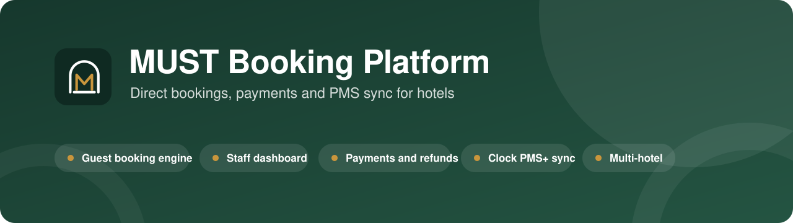
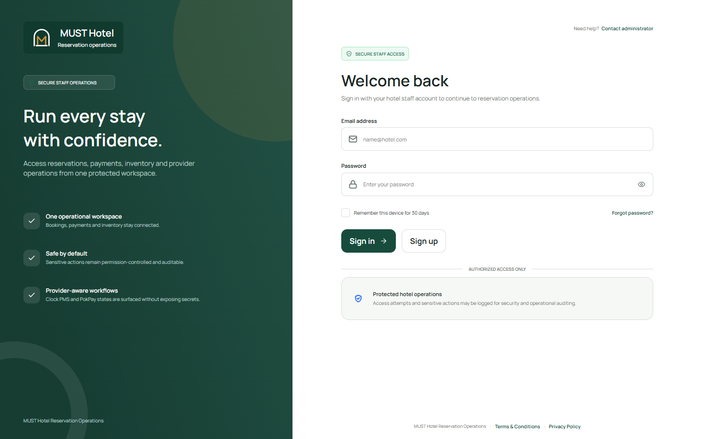
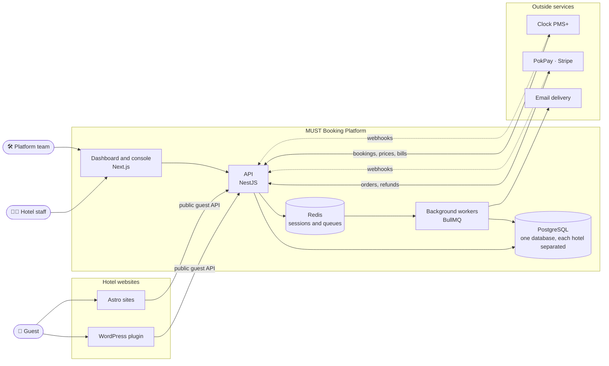
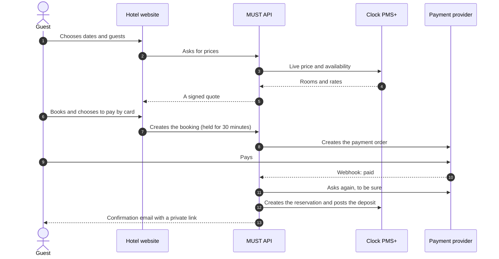
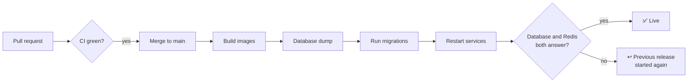

<div align="center">



<br><br>

[](https://github.com/MUST-DEV-TEAM/must-booking-platform/actions/workflows/ci.yml)
[](https://github.com/MUST-DEV-TEAM/must-booking-platform/actions/workflows/deploy.yml)
[](https://github.com/MUST-DEV-TEAM/must-booking-platform/actions/workflows/uptime.yml)


**A booking platform for many hotels at once.**<br>
Guests book and pay on the hotel's own website, staff run every stay from one dashboard,<br>
and the hotel's property management system stays in step.

[Live site](https://booking.must.al) · [Documentation](docs/README.md) · [Product overview](docs/product-overview.md) · [Roadmap](docs/roadmap/README.md) · [Contributing](CONTRIBUTING.md)

</div>

---

## 📖 Contents

- [What it is](#-what-it-is)
- [Features](#-features)
- [A look at it](#-a-look-at-it)
- [How it fits together](#-how-it-fits-together)
- [How a booking travels](#-how-a-booking-travels)
- [Tech stack](#-tech-stack)
- [Repository layout](#-repository-layout)
- [Run it locally](#-run-it-locally)
- [Tests and checks](#-tests-and-checks)
- [Deploying](#-deploying)
- [Security and data](#-security-and-data)
- [Project status](#-project-status)
- [Working on this repository](#-working-on-this-repository)
- [License](#-license)

## 🏨 What it is

Hotels lose money on every booking that comes through an agency. MUST Booking gives a hotel its own way to sell rooms directly:

- a **booking engine** on the hotel's own website, with live prices and online payment;
- a **dashboard** where reception and management see and handle every booking, payment and guest;
- a **two-way link to Clock PMS+**, so a room sold on the website is taken in the hotel's system at once, and a change made at reception shows up online.

One installation serves many hotels. Each hotel is its own account with its own staff, rooms, prices, payment accounts and guests, kept apart from every other hotel in the database itself.

## ✨ Features

<table>
<tr>
<td width="50%" valign="top">

### 🛎️ For guests

- Live prices and availability, taken from the hotel's own system
- One room or several in a single order
- Pay by card, or pay at the hotel
- A private "manage my booking" link to see the booking and cancel it
- Cancellation and refunds by the hotel's own rules, shown before paying
- Emails for confirmation, payment, changes and refunds, in English and Albanian

</td>
<td width="50%" valign="top">

### 🧑‍💼 For hotel staff

- Bookings, calendar, guests and payments in one place
- Walk-in and phone bookings
- Full and partial refunds, with the history kept
- A review list of what needs a person, with the reason
- Staff accounts with roles and permissions
- Reports, and every sensitive action in an audit log

</td>
</tr>
<tr>
<td width="50%" valign="top">

### 💳 Payments

- **PokPay** and **Stripe**, on each hotel's own merchant account
- Pay at hotel and manual settlement
- Every payment and refund kept in the platform's own ledger
- A payment is confirmed by asking the provider again, never from the browser
- Nightly checks that the ledger and the provider agree

</td>
<td width="50%" valign="top">

### 🔄 Clock PMS+

- Room types, rooms and rates read from Clock
- Live pricing and availability
- Website bookings created as real reservations in Clock
- Webhooks, so a change at reception arrives within seconds
- Payments and refunds posted to the guest's bill
- Retries, back-off and a dead-letter queue when Clock is unreachable

</td>
</tr>
<tr>
<td width="50%" valign="top">

### 🌐 For the hotel's website

- A **WordPress plugin** with Elementor widgets
- A **public guest API** for sites built with Astro or anything else
- Photos, amenities and room descriptions managed in the dashboard

</td>
<td width="50%" valign="top">

### 🛠️ For the platform team

- A separate console for all hotels: accounts, plans, support
- "View as" a hotel for support, recorded in the audit log
- Health of each hotel's integrations at a glance
- Alerts by email when something needs attention

</td>
</tr>
</table>

Some areas are partial or planned: restaurant reservations, paid platform subscriptions, a direct channel manager. The [product overview](docs/product-overview.md) gives the real state of each area.

## 👀 A look at it

<div align="center">

<br>
<sub>The staff sign-in page. Dashboard screens hold guest data, so they are not shown here.</sub>
</div>

## 🧩 How it fits together



## 🧭 How a booking travels



The API never trusts the browser about money: a payment counts only after the provider confirms it to the server. Each step leaves a record, so a repeated webhook or a retry does not book or charge twice.

## 🧱 Tech stack

| Layer               | Technology                                                 |
| ------------------- | ---------------------------------------------------------- |
| API                 | NestJS 11 on Node.js 22, TypeScript                        |
| Database            | PostgreSQL 17 with row-level security, Prisma 6 migrations |
| Queues and sessions | Redis 7, BullMQ                                            |
| Dashboards          | Next.js 16, React 19                                       |
| Guest side          | A WordPress plugin (PHP); Astro for stand-alone sites      |
| Tests               | Vitest, Playwright, and a Clock sandbox account            |
| Delivery            | Docker Compose, GitHub Actions, images on GHCR             |

## 📁 Repository layout

```text
apps/
  api/                 The API, database schema and migrations, background workers
  web/                 The staff dashboard and the platform console
  wordpress-plugin/    The guest booking plugin for WordPress sites
  restaurant-demo/     A demo Astro site
packages/
  domain-contracts/    Shared rules and types of the booking domain
  shared-types/        Types shared by the API and the dashboards
  ui/                  Shared UI components
infrastructure/
  containers/          Docker Compose files and the deploy scripts
docs/                  Architecture, decisions, integrations, operations, roadmap, reviews
```

## 🚀 Run it locally

You need **Node.js 22+**, **pnpm 10+** and **Docker Desktop**.

```sh
pnpm install --frozen-lockfile
docker compose up -d                      # PostgreSQL and Redis
cp apps/api/.env.example apps/api/.env    # local-only values
pnpm --filter api prisma migrate dev
pnpm --filter api start:dev               # API on http://localhost:3000
pnpm --filter web dev                     # dashboard on http://localhost:3001
```

The API answers at `http://localhost:3000/health`. [CONTRIBUTING](CONTRIBUTING.md) has the full setup, including PowerShell commands and the two database connections.

## ✅ Tests and checks

```sh
pnpm -w build
pnpm -w lint
pnpm -w format:check
pnpm -w test
```

Every pull request runs in CI:

| Check                  | What it covers                                                     |
| ---------------------- | ------------------------------------------------------------------ |
| Build, lint and format | The whole workspace                                                |
| API tests              | In four parallel groups, each against its own PostgreSQL and Redis |
| Web and UI tests       | The dashboards and shared components                               |
| Browser tests          | Real user journeys with Playwright                                 |
| Clock staging tests    | Real bookings in a Clock demo account, never a real hotel          |

> [!WARNING]
> The API tests write to the database and Redis they are pointed at. Do not run them against data you care about. [Operations and testing](docs/operations/README.md) explains how to run them safely.

## 📦 Deploying

> [!IMPORTANT]
> A merge to `main` is a production deploy.



- One change per pull request, CI green, and the owner's approval before merging.
- Migrations are additive and must keep working with the previous release, because they are not rolled back.
- Separate workflows watch the live site: uptime, a live booking check and a server watch.

## 🔒 Security and data

- **Each hotel is separate in the database.** Row-level security decides what a request may read, and the API connects with a role that is not a superuser.
- **Secrets stay on the server.** Payment and PMS credentials are stored encrypted and are never sent to the browser.
- **Webhooks are verified** before anything is done with them, and each one is processed once.
- **Sensitive actions are recorded** in an audit log: refunds, role changes, support access.
- **Real hotels are never test data.** Tests use a sandbox hotel and the providers' test accounts.

Found a security problem? Please do not open a public issue. Write to the maintainers of [MUST-DEV-TEAM](https://github.com/MUST-DEV-TEAM) privately.

## 📊 Project status

The platform is in production with real hotels. Work in progress is a round of hardening that came out of four reviews in November 2026: the database, the backend, the frontend, and the booking and payment flow.

| Where to look                                      | What you find                                          |
| -------------------------------------------------- | ------------------------------------------------------ |
| [Roadmap](docs/roadmap/README.md)                  | What is being worked on, what is planned, what is done |
| [Hardening queue](docs/roadmap/hardening-queue.md) | The current fixes, one small change at a time          |
| [Decisions](docs/decisions)                        | Why things are built the way they are                  |
| [Changelog](CHANGELOG.md)                          | What changed                                           |

## 🤝 Working on this repository

- [AGENTS.md](AGENTS.md) is the rule set for people and for coding agents: tenancy, money, PMS, migrations and verification.
- [CONTRIBUTING](CONTRIBUTING.md) covers setup, checks and pull requests.
- [Documentation](docs/README.md) is the entry point for architecture and integrations.

## 📄 License

Proprietary. An internal project of [MUST-DEV-TEAM](https://github.com/MUST-DEV-TEAM). The WordPress plugin keeps its own GPL-2.0-or-later license.
