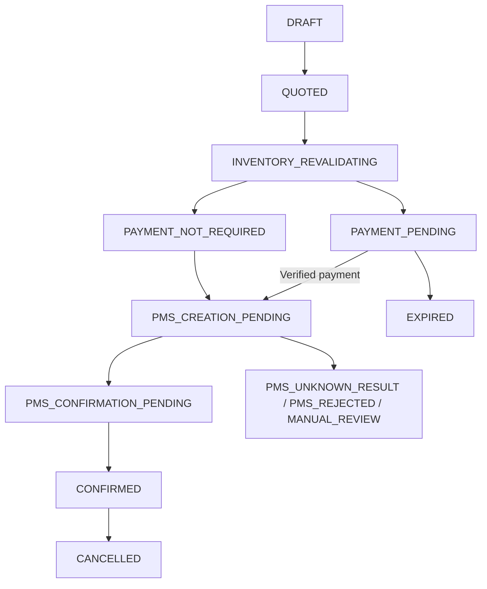

# Booking, inventory and guest payments

Status: **IMPLEMENTED**, with partial provider guarantees identified below. Code inspected 2026-09-19. Paths are repository-relative.

## Main entry points

| Concern | Source |
| --- | --- |
| Guest single booking and order endpoints | `apps/api/src/booking/booking.controller.ts` |
| Staff creation/cancellation | `booking/staff-booking.controller.ts` under the same API source root |
| Checkout orchestration, payment continuation, cancellation/expiry | `booking/local-pms.provider.ts` |
| Multi-room reservation | `booking/multi-room-booking.service.ts` |
| Pricing, rules and signed snapshot | `booking/quote.service.ts` |
| Inventory and physical-room claims | `tenancy/availability.service.ts` |
| State graph and projection | `booking/booking-state-machine.ts`, `booking/booking-projection.service.ts` |
| Verified gateway events, settlement, refunds | `payments/` |
| Clock fulfillment | [Clock lifecycle](../integrations/clock/booking-lifecycle.md) |

## Inventory and pricing

A stay occupies nights from `startsOn` through the day before `endsOn`. Room-type stock is `inventory_units.available_units - booked_units`, not the raw configured capacity. Missing nights cannot provide sellable stock. Database checks prevent negative or over-capacity booked counts.

Physical rooms use `room_availability`; manual blocks can target an entire property, room types, specific rooms, or combined targets. Modes are `ROOM_TYPE_ONLY`, `INDIVIDUAL_ROOM_ONLY`, and `MIXED`. Local MIXED auto-assignment requires same-price candidates. Inspect reservation SQL/locks and the last-unit/physical-room concurrency tests before changing this logic.

Local pricing uses the pure `booking/pricing-evaluator.ts` for quotes, dated public offers, calendar pricing and the staff explainer. Absolute-price precedence is room override, daily price, dated weekday override, then all-year base. The highest-priority matching adjustment applies once, followed by an optional single-level derived plan and confirmed mandatory charges. BigInt minor-unit arithmetic rounds each nightly component half away from zero. Every night must be priced; ambiguous ties, negative prices and overflow fail closed. Lifecycle, bulk transactions, scoped contracts and first-release limits are owned by the [Rates plan](../roadmap/milestones/24-rates-plan.md). Managed cancellation policies attach to rate plans. Clock-mapped types have a shadow local rate plan for relational bookkeeping, but their guest prices come from Clock `/products`, not local rate rules.

Local nightly snapshots additionally retain calculation component IDs, versions, names, amounts and charge disclosure. Issued quotes and existing booking totals are never repriced by configuration writes.

QuoteService creates a signed, session-bound snapshot (default 15 minutes) of scope, stay, selection, amount, nightly breakdown and normalized occupancy. Adults/children are primary; `guestCount` is a compatibility total. Validation checks expiry, signature, session binding and input consistency. Display-price caches are advisory and do not replace a quote or the final check.

## Staff date amendments (B2b v1)

`booking/booking-amend.controller.ts` exposes scoped `GET :bookingId/amend-preview?startsOn=&endsOn=` and `PATCH :bookingId/amend`. Both require `bookings.edit`; writes also require verified email. Confirm accepts dates, `expectedVersion`, `previewHash`, a required reason, `notifyGuest` (default false), and an `Idempotency-Key`. A scoped request hash gives identical replays and HTTP 409 for changed payloads. Confirm recomputes the preview under the property/booking locks and uses a booking-version CAS. Preview hashes cover scope, version, ledger balance, rule outcomes and the pricing-v2 calculation.

Only local confirmed/payment-not-required stays are eligible. Clock-managed/imported, cancelled, checked-out and completed stays are read-only; v1 conservatively also refuses stays reaching checkout today in the property timezone. Ambiguous shared order captures fail closed until finance can establish the per-booking payment split. Pending checkout amendments are deferred to avoid leaving a live payment link for an obsolete amount. The same room type, rate plan and assigned room are preserved; room/rate changes are deferred. New dates use current staff-channel pricing and shared property/restriction rules, with a 366-night v1 limit.

Availability reuses creation's pooled-stock and physical-room checks, excluding the booking's own hold. A savepoint rolls preview claims back; confirm releases old pooled nights, claims new nights and updates dates/total/nightly snapshots in one transaction. Assigned-room holds remain booking rows. Failure rolls back inventory, booking, audit and operation together. One audit entry records old/new dates and total, reason and actor. Search, overview, calendar and reports read the shared booking columns; existing report caching still applies.

No card charge or refund is triggered by an amendment, including for refund-capable staff. The new total minus paid less refunded is the resulting balance. Overpayments appear as a derived **Refund due** item on the booking; executing a separate existing refund still requires `payments.refund`. Collection uses existing manual payment/PokPay actions. `notifyGuest` invokes the existing booking-changed email after commit, retaining that service's eligibility, best-effort delivery and deduplication behavior; no new template or outbox is added.

## Shared booking and block rules

`apps/api/src/booking/booking-rules.ts` owns pure policy decisions. Quote validation, availability preflight, Clock minimum-stay projection and manual block validation call it; database inventory claims and reservation locks remain the final concurrency safeguards. The dashboard consumes evaluated results instead of reimplementing date or stay rules.

| Rule | Applies to | Source | Error code |
| --- | --- | --- | --- |
| Valid dates; checkout after check-in | Guest, staff, block | Requested ISO dates; half-open nights | `INVALID_DATE`, `INVALID_RANGE` |
| Start cannot be before today | Guest, staff, block | Property timezone, UTC fallback | `CHECK_IN_PAST`, `BLOCK_IN_PAST` |
| Minimum stay, inclusive boundary | Guest, staff | Property minimum; stricter Clock arrival minimum when available | `MIN_STAY` |
| Maximum stay, inclusive boundary | Guest, staff | Property maximum | `MAX_STAY` |
| Advance-booking limit, inclusive boundary | Guest, staff | Property advance days | `ADVANCE_BOOKING_LIMIT` |
| Same-day booking enabled and before cutoff | Guest and staff | Property timezone, enabled flag and cutoff time | `SAME_DAY_CLOSED` |
| Published type and active physical room | Guest and staff, preserving existing creation safety gates | Scoped catalog facts | `ROOM_TYPE_NOT_AVAILABLE`, `ROOM_NOT_AVAILABLE` |
| Adults plus children within occupancy | Guest, staff | Room type max occupancy | `CAPACITY_EXCEEDED` |
| Inventory remains available | Guest, staff | Local room stock and pooled stock in MIXED; Clock availability result | `NO_AVAILABILITY` |
| No assigned-room reservation overlap | Guest, staff | Active reservations; checkout equal to next check-in is permitted | `BOOKING_CONFLICT` |
| No applicable availability-block overlap | Guest, staff | Property/type/room blocks | `AVAILABILITY_BLOCK_CONFLICT` |
| Block never cancels a reservation | Block | Overlapping scoped reservations | `BLOCK_RESERVATION_CONFLICT` (HTTP 409) |

Pooled room-type reservations may overlap while inventory remains. Assigned-room reservations conflict directly. Existing overlapping manual blocks remain permitted; booking against them is rejected. Blocks do not apply booking stay length, advance, occupancy or publication rules. Local room types have no persisted individual minimum/maximum fields (G183); property rules apply. Unassigned pooled reservations are displayed in a ?Not assigned? calendar lane instead of being assigned to a physical room by the UI.

### Property booking settings

General, Booking rules and Check-in & out share the existing scoped property read/PATCH contract and `settings.manage` permission. Optional business/about and arrival-policy fields are stored on `properties`; the dashboard groups them with one dirty-only Save bar and an unsaved-change guard per area. Descriptive fields remain store/display only: the existing public catalog has no property-metadata envelope. No-show guidance is informational and never triggers a charge. Language choices describe offered languages, not automatic translations.

`allowSameDayBooking` maps to the existing `same_day_booking_allowed` column (default true); `sameDayCutoffTime` reuses the existing column. Same-day stays are refused at or after the cutoff in the property timezone, for both guest and staff bookings. Optional positive whole-number `maxGuestsPerBooking` and `maxRoomsPerBooking` apply to the whole order, including children. Single and multi-room creation recheck these settings in their existing transaction before creating bookings, so a previously issued quote cannot bypass a changed limit. Existing idempotent replays retain their original result.

Business country uses the ISO country list. Offered languages currently select from `en`, `sq`, `it`, `de`, `fr`, `es`, `el`, `tr`. Default currency is an informational preference and cannot be changed once scoped rate rules, daily prices or room price overrides exist; it does not convert rate-plan prices. Website links require HTTPS. Optional description is limited to 1000 characters; policy notes to 300. Quiet-hours times must be supplied together and may cross midnight. Free-until arrival policies require a time. Nullable fields preserve unspecified legacy policies; no-show defaults to review, early/late to not offered, and ID requirement to false.

### Scoped Inventory restrictions

Local properties also apply dated property/category/type restrictions through the same pure evaluator: min/max stay and arrival closure by arrival date, departure closure by checkout date, stop sell by sold night, minimum advance by arrival. Highest priority wins within each type/date, and equal-priority differing values fail closed. Settings stay limits are priority-0 fallback values; scoped exceptions can relax them. Manual blocks and stock claims remain independent safeguards. Restriction activation/versioned edits are serialized, audited and idempotent; they never mutate existing bookings. Enabled Clock properties suppress local restrictions and reject local restriction changes. The [Inventory contract](../roadmap/milestones/24-inventory-plan.md#i1-restrictions) owns lifecycle, validation, endpoints and evaluation assumptions.

### Dashboard rule evaluation contract

`GET /tenants/:tenantId/properties/:propertyId/booking-rules/evaluate` is read-only, requires `calendar.view`, and is tenant/property scoped. Optional query fields: `roomTypeId`, `roomId`, `startsOn`, `endsOn`, `adults` (default 1), `children` (default 0), `from`, `to` (disabled-day projection, at most 92 days). Response: `{ today, minStayNights, maxStayNights, pastDateMessage, disabledDates, booking: { valid, errors: [{ code, message }] }, block: { valid, errors: [{ code, message }] } }`. Without a selected range both results have `valid: false` and empty errors. Failed inventory verification returns `AVAILABILITY_UNVERIFIED` and disables booking. Physical-room actions under `ROOM_TYPE_ONLY` return `ROOM_ID_NOT_ALLOWED` and stay disabled (G184). Evaluation does not reserve stock; existing create routes revalidate and enforce their own capabilities. Manual block creation now rejects past or invalid ranges with HTTP 400. Reservation conflicts retain HTTP 409 and the existing conflict payload. No public endpoint or WordPress change is needed for this dashboard-only contract.

## Creation and payment lifecycle

The exact allowed graph is `BOOKING_STATUS_TRANSITIONS`; this diagram omits failure/cancellation edges for readability. Check-in/out are not distinct MUST BookingStatus values.

LocalPmsProvider validates catalog/mode/rules, quote and guest identity, reserves inventory under a scoped transaction, and selects an enabled payment method. A zero total may be FREE; a non-zero stay cannot silently become free because a gateway is unavailable. Guest-visible Stripe/PokPay options require the property toggle plus an enabled CONNECTED integration. Pay-at-hotel is an explicit option.

Before creating an online checkout session, single and multi-room bookings call `PrePaymentAvailabilityRegistry` (`booking/pre-payment-availability.ts`), which picks the property's PMS check; for Clock that is `ClockPrePaymentAvailability`, an uncached check: room types use rate availability, while physical rooms use overlap-list/detail reads. On failure the creation transaction is rolled back. This is not an inventory hold at Clock and cannot eliminate a sale race between the check and later payment. Multi-room online orders run the same uncached check for every room before checkout: all selected physical rooms share one Clock overlap read, and unassigned rooms are checked per room type and occupancy, requiring Clock to report at least as many free units as the order requests of that type. Pay-at-hotel orders (single or multi-room) create the Clock reservation immediately instead of pre-checking.

Online payment confirmation writes the charge and calls `continueAfterPayment`. Local-only bookings confirm locally; Clock properties attach the real reservation after verification and then attempt deposit posting. Pay-at-hotel/free flows attach without a gateway charge. A successful payment and a failed PMS operation are distinct outcomes requiring staff attention, not proof of confirmation.

## Guest payments and refunds

`PaymentProviderRegistry` chooses Stripe or PokPay using tenant/property credentials. Stripe verifies the webhook against the connection and payment details; PokPay re-reads the authoritative order rather than trusting browser/callback fields. Return pages are display/continuation surfaces, never payment proof.

The `payments` ledger records positive-valued CHARGE/REFUND rows, with provider IDs and currency, and deduplicates external payment IDs within the tenant. `payment_provider_sessions` preserves multiple checkout sessions for the same booking (including resent PokPay links). Staff can record cash/card-in-person/bank-transfer payments; a paid pending booking reuses fulfillment.

`PaymentExpiryService` runs every minute, polls pending PokPay orders, then expires up to 100 candidates older than 30 minutes. It rechecks/locks state in tenant transactions and releases reserved inventory, including pending siblings of an order. Late authoritative payments require the provider-specific handling; do not assume expiry cancels a gateway session.

Cancellation is orchestrated through LocalPmsProvider, including Clock cancellation, local inventory release and refund policy. Legacy bookings evaluate current rate-plan cancellation values; the evaluated outcome is captured at cancellation. Staff use authenticated context; guests use a signed cancellation link. `PaymentRefundService` handles automatic refunds and staff full/fixed/percentage refunds with notes, remaining-balance checks, locking and idempotency. A staff percentage is a share of what is still refundable, not of the original charge (50% after a 50.00 refund of a 250.00 payment is 100.00, decided 2026-10-01); a fixed amount is capped at what is left, and the refund dialog shows the exact amount before it is confirmed. Every provider refund must reach the ledger under its own payment id: PokPay returns the order's one transaction id for all of its refunds, so the PokPay provider derives a per-refund id from the idempotency key.

For Clock-attached manual refunds, mirroring happens after the local refund transaction; failures produce manual review and do not reverse a completed refund. Clock requires a human Deposit Adjustment step: see the [Clock lifecycle](../integrations/clock/booking-lifecycle.md). No general settlement/payout system exists.

### Staff edit details (B2a)

`PATCH bookings/:id/details` requires `bookings.edit`, verified email, `expectedVersion` and `Idempotency-Key` (up to 200 characters). It accepts only `firstName`, `lastName`, `email`, `phone`, `specialRequests`, `estimatedArrivalTime` (HH:mm in hotel local time), `adults` and `children`. Stale versions return 409; identical key/payload replays return the original version without another history entry. Dates, room, rate, amounts and payment state are rejected.

Contact edits live in the booking's `guest_contact` snapshot, leaving the tenant-wide guest directory and other reservations unchanged. Booking projections, permission-gated global search, operational lists and later booking emails read this scoped contact. The edit itself sends no email; no explicit confirmation-resend route exists. The existing booking audit stores actor, timestamp and each field's old/new values. Clock-connected properties and bookings with a Clock reference are read-only, including when no provider request is needed.

Guest counts must fit the room. For count changes, both current and proposed occupancy are evaluated using current local pricing facts in the edit transaction; both totals/currencies must match the stored booking total. Unavailable or changed pricing fails closed and points to the future amend stay flow. Other details can be corrected without repricing. Detail reads include `detailsManagedInClock`, `maxOccupancy` and `estimatedArrivalTime` for the shared Edit details dialog.

### Staff cancellation and approval (B1)

`GET bookings/:id/cancellation-preview` evaluates the current rate plan at property-local arrival midnight minus its free-cancellation hours. The deadline is inclusive; a missing or expired free window retains the booking total. Amounts use integer minor units. `POST bookings/:id/cancellation` requires `bookings.view`, a matching preview hash/version, reason, priority and details. Staff with `bookings.cancel` cancel within policy directly; missing permission, outside-policy and custom-refund cases create a Pending request instead. Custom amounts additionally require `payments.refund`. The existing staff DELETE route delegates to this contract.

`GET requests` and `POST requests/:id/decision` require `requests.review` (automatically available to Owner/Admin; existing staff grants stay unchanged). Notes are required. At decision time, a requester may approve only as an Owner/Admin with no other active reviewer for that property; the transaction checks memberships and effective staff grants/revokes, excluding suspended staff. The immutable decision records `selfApproved`, shown on recent decisions in Approvals. Forced RLS and composite booking foreign keys enforce exact tenant/property scope; a partial unique index permits one Pending request per booking/type. Pending cancellation badges are derived when bookings are read. Decisions resolve the request notification with the reviewer's identity.

Approval execution records its reviewer/note before invoking the existing LocalPmsProvider cancellation and PaymentRefundService refund paths with stable operation keys. A scoped advisory lock serializes creation, direct cancellation and review. If a decision write is interrupted after execution, the original reviewer can resume with the same note. Failed provider cancellation leaves the request Pending and creates existing manual-review evidence; it issues no refund. Refund failure after successful cancellation is reported separately. B1 staff cancellation targets one booking within an order, keeping per-booking operation keys. Its refundable share is bounded by its own total/remaining payment and the order balance. Booking-owned payments with an unambiguous split are supported; pooled captures without a recorded split, mixed currencies and multiple captures fail closed with a finance-review message. Guest whole-order cancellation is unchanged.

## Multi-room and concurrency boundaries

MultiRoomBookingService locks the selected room-type inventory in deterministic order and reserves the group in one transaction before proceeding. Children share an order reference; online payment is anchored to one booking for the aggregate amount. Fulfillment/cancellation fans out per room. External Clock operations cannot be rolled back as one atomic group: successfully cancelled children remain cancelled and failed siblings retain manual-review evidence.

Creation/update/cancellation/refund paths use `integration_operations`: tenant-scoped idempotency key, request hash, stored result and attempts, with conflict on key reuse for a different request. Booking `version` is an independent optimistic counter; Clock's `lock_version` is fetched for vendor updates. No database transaction makes a payment or Clock HTTP request atomically commit with local storage.

Outbound HTTP still occurs in some interactive transactions (30-45 second overrides). Review timeout/commit ambiguity and recovery using real behavioral tests; a typecheck does not establish idempotency under failure.

## Current gaps relevant to planning

- Public `PATCH /tenants/:tenantId/properties/:propertyId/bookings/:bookingId` forwards expectedVersion/total, not stay dates, even though provider methods can update dates. A staff date-change feature is not already exposed.
- Clock webhook hydration writes projections directly and does not run the full local booking transition/inventory/refund orchestration. A mirrored Clock cancellation is not proof of a MUST refund or released local inventory.
- Group availability/payment-accounting semantics need their own checks; do not project single-room guarantees onto orders. Clock reconciliation currently selects bookings with a local charge, while an order charge is anchored.
- Final price, reservation, charge, refund and folio balance are separate facts. See [Clock review gaps](../integrations/clock/architecture.md#known-gaps-and-deviations) before planning a provider change.

Property payment settings (migration `20261021090000_payment_brand_settings`) default `onlinePaymentHoldMinutes` to 30 (10-1440) and `autoRefundOnFreeCancellation` to true. The privileged expiry candidate function retains its existing 30-minute-cutoff argument contract but offsets by each property's configured hold; the tenant/property-scoped expiry transaction rechecks the current setting. Local single-booking and order automatic free-cancellation refunds respect the boolean. Explicit staff refund choices remain separate and capability gated. Changes apply to existing pending bookings/free cancellations at evaluation time; no deposit or tax behavior changes.
